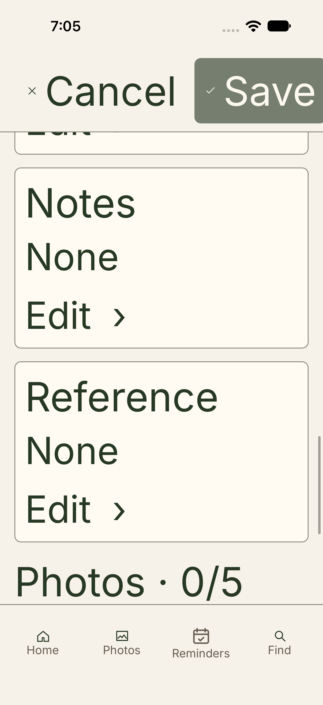

# Add-form accessibility correction — 2026-11-15

Follow-up to [the scoped investigation](VOICEOVER_ADD_ACCESSIBILITY_20261115.md), on the same authorized feature branch, Mac mini only. No push, merge, release, purchase or production change in this follow-up.

## Corrected and verified

- Optional Location/Notes/Reference summaries now stack their Edit affordance below the text at system font scale >=1.35 or the in-app Large text setting. Normal-size horizontal layout is retained. Text scaling is not capped or disabled.
- **Reference** is visually verified as one intact word at iOS accessibility-extra-extra-extra-large. The complete label/value/Edit row is visible and operable.
- The prior Done editing Location failure was a QA scroll-helper problem for the tested case: near-full-viewport drags oscillated the tall control past the viewport. Measured corrections capped at 120 points resolved it. No application interaction change was needed for Done.
- Native full Add layout check **PASS** in Light and Dark, 1 test / 0 failures, 71.183 seconds: real under-limit form, Space/Category choices, Location/Notes/Reference open and Done, fixed Save/Cancel, lower Add Photo control reachable. The photo action was not opened; completed photo acceptance was not repeated.
- Separate Reference capture test **PASS**, 1 test / 0 failures, 23.508 seconds. Screenshot was visually inspected, not inferred from test exit status.
- TypeScript and full source ESLint PASS; full automated suite **498 total / 492 passed / 6 existing skips / 0 failed**. Added source regression guard for enlarged optional-field layout. Both new/changed Swift tests compiled in native runs.

## Artifact and preservation

Only fresh simulator `189233C4-A360-49D7-AB2A-C9A7F02B9060`, iPhone 18 Pro / iOS 27.0, received the rebuilt `com.designsbyfa.casitadex.plusstoreqa` artifact. Embedded JS SHA-256: `f726b5da5dc219eee9672a49c80ab7e3ce0db56f50dc8cf40b235459eb40b12b`.

Existing disposable QA simulator retained its installed JS SHA `50970f92541c401b8a6ae4f5fdd5194945f2c72adcc28b4e01976299c106e349` and exact saved payload SHA `829ae84e387b31d5c7585c026670a2d7a38b8bbb836daea0ce229d739a71bee8`. Accepted SB40 and physical devices were not targeted.

Fresh fixture retained the same 19 memory IDs. Its full payload was not invariant: QA startup re-seeded synthetic media and associated events for three sample records. Do not describe the fresh fixture as byte-for-byte unchanged. No existing collection was reduced or restored.

Fresh simulator font size restored to large and shut down; previous QA simulator boot restored. Source and staging changes limited to the optional-field component and QA helpers/tests. Older failed attempts remain retained.

## Evidence and remaining scope

External SSD `QA-Evidence/CasitaDex-Add-Accessibility-20261115/`: `source-fix-tests.log`, `Add-fixed.log`, `Add-fixed.xcresult`, `Reference-fixed.log`, `Reference-fixed.xcresult`, four `fixed-add-*.png` captures, `reference-large-fixed.png`.

This closes the observed Reference wrapping defect and the bounded optional-field reachability failure on this iOS profile. It is not complete Add accessibility certification: keyboard text-entry/edit persistence, other sizes/orientations, Android rebuilt parity, TalkBack, extended VoiceOver and physical-device acceptance remain separate. Existing Home VoiceOver speech PASS remains scoped to its original artifact, not relabeled as tested on the rebuilt artifact. Release remains NO-GO.
