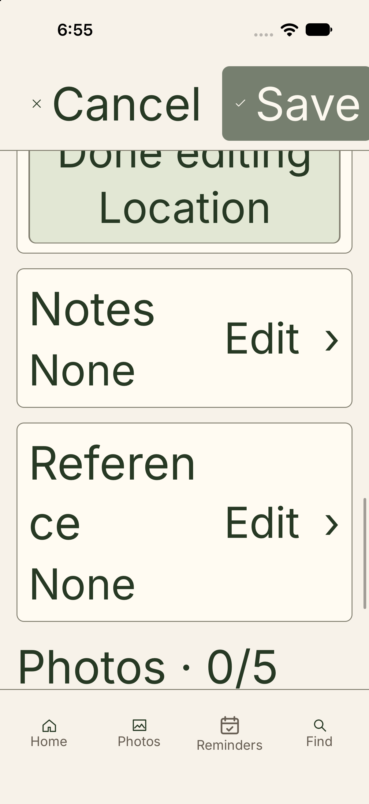

# Scoped VoiceOver and full Add-form accessibility investigation

Date: 2026-11-15. Mac mini only. Starting source: clean `work/cd-plus-backup-safety-20261114@e429a8d9366c6ffe692b4e16412a6a9e3508f415`. No application source changes, release, purchases, production writes or repeated photo acceptance.

## Native artifact and isolation

iOS 27.0, iPhone 18 Pro simulator, `com.designsbyfa.casitadex.plusstoreqa`. Retained embedded JS SHA-256: `50970f92541c401b8a6ae4f5fdd5194945f2c72adcc28b4e01976299c106e349`. Native staging is the existing detached `9686cb1` checkout with copied implementation changes; do not describe it as clean source HEAD.

Only the long-lived Android emulator job was active at preflight; no concurrent native build/test process was observed. Accepted SB40 and physical installations were not targeted.

## VERIFIED PASS: scoped Home VoiceOver speech

`testVoiceOverHomeProbe20261115` uses real XCUIVoiceOverService on disposable simulator `81FC3CCE-ACEB-4957-BE61-C9C653A4CE56`. Native result: one test, zero failures, 39.820 seconds. Actual utterances, in traversal order:

1. Settings Button
2. Find a memory Heading
3. Find a memory Button
4. Add Memory Button
5. Add Photo Memory Button
6. Add Reminder Button
7. selected Home
8. Photos
9. Reminders
10. Find

Further forward moves repeated Find at the traversal end. This verifies spoken output and this scoped traversal, not full screen-reader operation, activation, hints, rotor behavior, speech quality, all-screen focus order or TalkBack acceptance.

VoiceOver initially disabled; cleanup preference `VoiceOverTouchEnabled=0` verified. Original disposable QA collection remains 20 memories, exact full-payload SHA-256 `829ae84e387b31d5c7585c026670a2d7a38b8bbb836daea0ce229d739a71bee8`, matching the prior checkpoint. Older summaries saying 19 memories were stale.

Initial probe compile attempt failed on the iOS availability annotation and imported API spelling. Those QA harness errors were corrected before the successful run; not application failures.

## OPEN / FAIL: full Add form at maximum accessibility text

Prior large-text acceptance showed only the free-plan limit screen. A fresh independent simulator `189233C4-A360-49D7-AB2A-C9A7F02B9060` was installed with the retained artifact and prepared with a synthetic under-limit fixture. Existing data was never reduced. Size: accessibility-extra-extra-extra-large.

The corrected fixture reached the real Add form. Existing native `testAddLayoutThemes` reached Light appearance, taxonomy choices and Location editing, then failed to fully reveal **Done editing Location**. Its scroll helper exhausted its bounded attempts. This remains an interaction/harness diagnosis; a partially hidden control does not alone prove it cannot be operated manually. The Dark iteration and remaining fields were not completed.

A screenshot inspected during the attempt separately establishes a visual issue: the **Reference** label wraps mid-word as **Referen / ce** beside Edit. Done editing Location was partly under the sticky actions in that captured scroll position. Full Add-form large-text acceptance is NOT passed.

Two setup failures are retained, not hidden: an initial simulator clone reported the old app-container path, so its safety assertion stopped before any fixture write; a fresh-fixture first attempt had dangling media references and was corrected using the existing boundary-fixture pattern (all fixture photo references cleared). Neither failure is counted as an application defect or pass.

## Cleanup and next action

Fresh simulator text size restored to large and device shut down. Unused clone also shut down. Original disposable QA simulator boot restored; unchanged collection hash verified afterward. No existing records deleted. New fixture snapshots and all failed/successful logs remain private on the SSD.

Next: diagnose/fix the Reference row at extreme text size and distinguish scroll-helper oscillation from native reachability of Done, then complete remaining Add fields and Dark coverage on the fresh device. Extend VoiceOver beyond Home and perform real Android TalkBack traversal. No TalkBack pass claimed in this batch. Physical-device and release acceptance remain separate and OPEN.

## Evidence retained on external SSD

Under `/Volumes/FA-Development/Designs-by-FA/QA-Evidence/`:
- `CasitaDex-VoiceOver-Probe-20261115.log/.xcresult`: initial compile failure.
- `CasitaDex-VoiceOver-Probe-r2-20261115.log/.xcresult`: successful speech probe.
- `CasitaDex-Add-Accessibility-20261115/Add.log`, `Add.xcresult`: invalid-fixture attempt.
- `CasitaDex-Add-Accessibility-20261115/Add-r2.log`, `Add-r2.xcresult`: corrected-fixture full-form failure.
- `CasitaDex-Add-Accessibility-20261115/large-add-location-live.png`: reviewed screenshot.

Release decision remains NO-GO. This evidence supersedes neither the owner-approved design nor completed photo acceptance.
